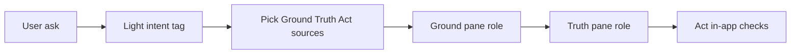

# Browser Experience — Ground / Truth / Act (near-term only)

**Locked:** sequential single live pane (`1A`).  
**Act (`2A`):** in-app checks in the right panel — visible step on the `Ground · Truth · Act` strip so you can observe Act without a third external site.  
**Out of scope for this build:** parallel 3-pane split, keystroke latency routing, Quizlet/external study apps, AWS/console OAuth, DOM quiz gates, multi-Browserbase sessions.

## What we already have

- `/browser` + Browserbase live iframe (user can interact while agent drives)
- One Playwright page per session: search → verify → teach beats → highlight + voice
- Follow-up reuses the same session

## What we build

Extend the **existing** ask pipeline so one lesson walks three **roles** in order inside the same live browser + right script panel.

### 1. Workspace roles (data model)

Add a small role model next to beats (not a new session type):

- `role`: `ground` | `truth` | `act`
- Each of Ground/Truth: `{ url, title, deepLink?: { text | seconds } }`
- Act: `{ questions: [{ prompt, choices?, answer }] }` generated in-app (2–3 items)

Emit over SSE (new event or extend `session` / `beats`) so the UI can show a **Ground | Truth | Act** step strip.

### 2. Search / matrix planning (server)

In [`runAsk.ts`](../src/lib/browser-experience/runAsk.ts) after Tavily (and optional YouTube):

1. Classify lightly: `concept` vs `debug` vs `default` (text heuristic / one small LLM call — no keystroke timing).
2. Select up to:
   - **Ground:** YouTube or visual/demo page when useful; else skip and start at Truth
   - **Truth:** best verified article/docs page (today’s selected source)
   - **Act:** always in-app questions derived from Truth extract + question
3. Cap: never more than one live navigation target at a time; skip empty roles.

### 3. Sequential teach loop

Replace “single page then all beats” with role phases:

1. Open Ground → beats that highlight/seek on that page → short speech  
2. Navigate to Truth → clear annotations → Truth beats  
3. Stay on Truth (or blank status) → play Act as right-panel Q&A (no third external site)

Reuse existing annotate + speak path in [`BrowserExperienceWorkspace.tsx`](../src/components/browser-experience/BrowserExperienceWorkspace.tsx).

### 4. UI (minimal)

In workspace chrome / script column:

- Step strip: `Ground · Truth · Act` with active role highlighted  
- Act: show 2–3 checks; submit advances / completes lesson  
- Keep single [`BrowserChrome`](../src/components/browser-experience/BrowserChrome.tsx) live iframe

### 5. Templates (v1 only — one orchestrator, two fill rules)

| Intent | Ground | Truth | Act |
|--------|--------|-------|-----|
| concept / STEM | YouTube @t when found | Best article / wiki / paper-ish page | In-app checks |
| debug / SWE | Skip or eng-blog diagram if found | Official docs / SO-accepted-like page | In-app checks (“what failed / fix”) |

No separate products — same pipeline, different fill.

## Files likely touched

- [`src/lib/browser-experience/types.ts`](../src/lib/browser-experience/types.ts) — roles + Act questions + stream events  
- [`src/lib/browser-experience/schemas.ts`](../src/lib/browser-experience/schemas.ts) — zod for matrix / Act  
- [`src/lib/browser-experience/runAsk.ts`](../src/lib/browser-experience/runAsk.ts) — matrix plan + sequential navigation  
- [`src/lib/browser-experience/teach.ts`](../src/lib/browser-experience/teach.ts) — plan beats per role + Act generation  
- [`src/lib/browser-experience/search.ts`](../src/lib/browser-experience/search.ts) / youtube — ground candidate when needed  
- [`src/components/browser-experience/BrowserExperienceWorkspace.tsx`](../src/components/browser-experience/BrowserExperienceWorkspace.tsx) — step strip + Act UI + phase playback  
- smoke: [`scripts/smoke-browser-experience.ts`](../scripts/smoke-browser-experience.ts)

## Current behavior note — Sources (N) vs teach target (1)

**Not a hidden OCR bug.** As of the sequential `1A` build:

- Tavily / YouTube search can **cite many** URLs → UI `Sources (5)` is cumulative (every candidate we open/emit).
- `findVerifiedPage` / `findVerifiedYouTube` still pick **one** winner for Truth (and optional one Ground video).
- Highlight / OCR / navigation / teach beats run **only on the active role page** (Ground video *or* Truth article), not across all five citations.

So “how to find a job” with Sources (5) but highlights on one site is **expected today**. Multi-source walkthrough is the next product step (below), not a regression.

YouTube remains a first-class **Ground** source for the future 3-tab matrix.

## Explicitly not building in the current `1A` slice

- Parallel iframes / 3 live views *(moved to next phase — see below)*  
- Keystroke latency expert/novice score  
- Quizlet, Coursera, Zotero, etc.  
- Authenticated cloud consoles  

## Next phase (broad plan — after review/test of current `/browser`)

### A. Multi-tab / multi-source orchestration
- **≥3 tabs** aligned to matrix roles, e.g. Ground (YouTube) · Truth (article) · optional third source / Act context.
- Teach + OCR/highlight **walks each selected tab**, not only the single verified winner.
- Keep cumulative Sources list; each tab has a primary source; transcript tags which tab/source is active.
- Exact YouTube transcript clocks (`1:30`) synced to `youtube_seek` seconds (polish); optional captions later for content-true chapters.

### B. Interpretive narration engine (not AI-slop verbatim)
- Voice + right-panel transcript should **interpret** the page for the student’s question — synthesize, compare, warn, next step — not read OCR/anchors line-by-line.
- Prefer: “Here’s what this section means for finding a job…” over dumping page sentences.
- Still ground every claim in visible page/video evidence (highlights/seeks stay honest).
- Apply to both Ground (video moments) and Truth (article anchors).

### C. Infra already in flight
- Local Chromium Take control + in-app click relay; cloud Browserless/Browserbase as fallback.
- CAPTCHA / Google sign-in as intentional human handoff tests.

## Take control (CAPTCHA / “I’m not a robot”) — Muse-style handoff

Browser tab only (`/browser`):
1. **Take control stays clickable** even while search/teach is running (agent pauses on `userControl`).
2. Cloud: LiveURL when available; local: JPEG mirror + click/type relay in-pane.
3. Resume continues the teach loop (does not hard-abort narration).
4. Soft-skip Google *search* walls so lessons can continue to verified sources.

## Done when (`1A`)

1. One ask produces a visible Ground → Truth → Act progression (Ground may skip).  
2. Truth still deep-highlights; YouTube Ground still seeks when used.  
3. Act is 2–3 in-app checks in the right panel.  
4. Sources list can show N citations even while teach targets 1 page (documented above).  
5. Smoke covers role event shape + skip-Ground path.
